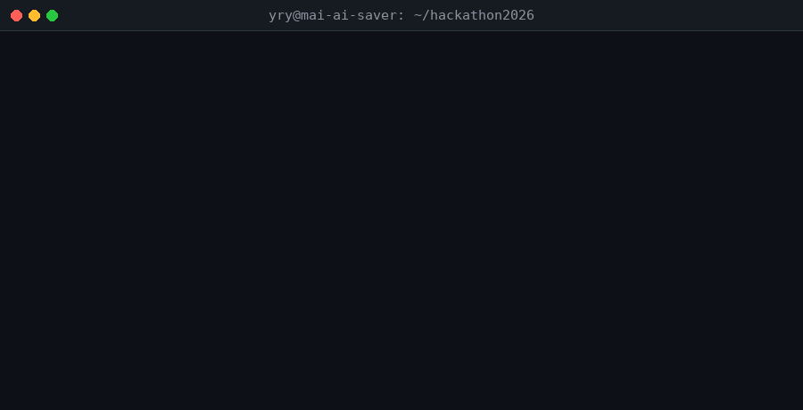

# 🍔 麦麦省钱助手 (Mai-AI Saver)

> **1024 程序员节的午餐救星** —— 花最少的钱，吃最像样的一顿。
> 基于麦当劳 MCP 能力的智能点餐省钱 Skill · 2026 麦当劳程序员创意开发大赛参赛作品


## 📺 30 秒 Demo



📹 **完整演示视频**（26 秒，720p）：[docs/demo.mp4](docs/demo.mp4) —— 含片头卡片、三个场景（必点升套餐 / 预算午餐 / 优惠券试算）、片尾，可用于大赛报名演示与社区发帖。

🔊 **解说版**：[docs/demo_narrated.mp4](docs/demo_narrated.mp4) —— 同内容 + 专业男声旁白（edge-tts 合成，台词见 [NARRATION.md](NARRATION.md)），适合直接投稿参赛。

## 💡 为什么是 1024 的午餐

1024 程序员节这天，别人在抢黑客松的 DEADLINE，你在麦当劳柜台前面对 40+ 个 SKU 和 5 张优惠券疯狂心算——

- 单点汉堡+薯条+可乐，还是直接上套餐？
- 满 50 减 8 和全场 85 折，凑哪个？
- 预算 30，怎么配才能"有主食有饮料不像乞丐餐"？

**麦麦省钱助手把这道心算题交给算法**：输入预算和口味偏好，输出最优搭配 + 券后价 + 省钱依据。让程序员把脑子留给代码，把午餐交给麦麦。

## ✨ 核心能力

| 能力 | 说明 |
|------|------|
| 🧮 **预算内最优搭配** | 约束过滤 + 有界枚举，「满足度 + 餐食完整度」双维打分，拒绝小食拼盘凑数 |
| ⬆️ **单品自动升套餐** | 说"想吃巨无霸"→ 自动升级"巨无霸套餐"，并明确告知省了多少（核心省钱逻辑） |
| 🎟️ **优惠券智能匹配** | 支持满减 / 折扣（封顶）/ 单品券三型，按实省金额排序推荐 |
| 🔌 **MCP 实时数据** | 标准 MCP JSON-RPC 2.0 客户端，菜单/券/门店/活动实时获取，失败自动降级离线演示数据 |

## 🚀 快速开始

```bash
git clone https://github.com/yaorenyun/mai-ai-saver.git
cd mai-ai-saver

# 场景 1：必点巨无霸，预算 50（自动升档套餐）
python3 scripts/price_optimizer.py --budget 50 --must big_mac

# 场景 2：预算 30 元的打工人午餐
python3 scripts/price_optimizer.py --budget 30

# 场景 3：不吃辣，预算 25
python3 scripts/price_optimizer.py --budget 25 --exclude-tags 辣

# 场景 4：优惠券试算
python3 scripts/coupon_matcher.py --items big_mac fries_l coke_l
```

## 📊 真实运行效果

### 预算 ¥50 · 必点巨无霸 → 自动升档套餐

```
🍔 麦麦省钱助手｜预算 ¥50.00｜必点 ['big_mac']｜排除 无

[提示] 「巨无霸」已自动升级为「巨无霸套餐」（套餐比单点省 ¥7.50）

🥇 方案 1｜合计 ¥45.50｜综合得分 32（满足度 21 + 完整度 11）｜🍽️ 完整正餐
   · 巨无霸套餐  ¥39.50  [套餐] （比单点省 ¥7.50）
   · 圆筒冰淇淋  ¥6.00  [甜品]
```

### 预算 ¥30 · 打工人午餐

```
🥇 方案 1｜合计 ¥28.50｜综合得分 21（满足度 12 + 完整度 9）｜🥤 轻食档
   · 双层吉士堡  ¥16.50  [主食]
   · 珍珠奶茶  ¥12.00  [饮料]
```

### 优惠券匹配：巨无霸 + 大薯条 + 大可乐（¥51.50）

```
👑 最优 满50减8｜实省 ¥8.00｜订单 ¥51.50 满 ¥50｜券后 ¥43.50
  备选 全场85折｜实省 ¥7.73｜订单 ¥51.50 × 0.85（封顶 ¥10）｜券后 ¥43.77
```

更多案例见 [examples/demo-cases.md](examples/demo-cases.md)（含预算不足的风控案例）。

## 🏗️ 项目结构

```
mai-ai-saver/
├── SKILL.md                  # Skill 主文件：触发规则 + 五步工作流
├── CONTEST_DECLARATION.md    # 【大赛必需】参赛声明（原创性/合规性/敏感信息）
├── MCP_INTEGRATION.md        # 【大赛必需】MCP 接入说明（Server/Tool/流程/价值）
├── mcp-config.example.json   # 【大赛必需】脱敏 MCP 配置示例（仅环境变量占位符）
├── workbuddy.md              # 【大赛必需】WorkBuddy 开发记录（专项奖励凭证）
├── scripts/
│   ├── price_optimizer.py    # 组合优化引擎（必点升档 / 约束过滤 / 有界枚举）
│   ├── coupon_matcher.py     # 优惠券匹配器（满减 / 折扣 / 单品券）
│   └── mcp_client.py         # 麦当劳 MCP 客户端（stdio + JSON-RPC 2.0 + 降级）
├── tools/
│   ├── make_demo_gif.py      # README 演示 GIF 生成器（Pillow 终端动画）
│   ├── make_demo_video.py    # 演示视频生成器（720p@30fps → H.264）
│   └── make_narration.py     # 旁白合成与混音（TTS + 去 AI 味后期链）
├── references/
│   ├── menu-data.json        # 离线演示数据（MCP 不可用时兜底）
│   └── workflow.md           # 详细工作流与边界情况
├── examples/
│   └── demo-cases.md         # 三个完整演示案例
├── docs/
│   ├── demo.gif              # README 演示动画
│   ├── demo.mp4              # 完整演示视频（26 秒 720p）
│   └── demo_narrated.mp4     # 解说版视频（带旁白）
├── SUBMIT_GUIDE.md           # 参赛提交傻瓜流程（零基础版）
├── POSTS.md                  # 社区发帖文案（三平台）
└── NARRATION.md              # 旁白脚本与去 AI 味说明
```

## 📋 大赛合规文件清单

本仓库已按《麦当劳程序员创意开发大赛活动规则》备齐全部必需文件：

| 官方要求 | 对应文件 | 状态 |
|----------|----------|------|
| README.md（项目介绍/安装/示例/目标用户） | `README.md` | ✅ |
| CONTEST_DECLARATION.md（原创性/合规性/敏感信息） | `CONTEST_DECLARATION.md` | ✅ |
| MCP_INTEGRATION.md（Server/Tool/调用流程/业务价值） | `MCP_INTEGRATION.md` | ✅ |
| mcp-config.example.json（脱敏配置，仅环境变量占位符） | `mcp-config.example.json` | ✅ |
| workbuddy.md（WorkBuddy 对话上下文，专项奖励） | `workbuddy.md` | ✅ |
| 基于麦当劳 MCP 开发 | `scripts/mcp_client.py` + 降级链路 | ✅ |
| 仓库公开可访问 | 创建时设为 Public | ✅ |

## 🔌 MCP 接入

本 Skill 通过标准 MCP 协议（JSON-RPC 2.0 over stdio）调用麦当劳 MCP server，
默认启动命令：`npx -y @mcdonalds-china/mcp-server`（以官方仓库为准），
可通过环境变量 `MAI_MCP_COMMAND` 覆盖。

**MCP 不可用时自动降级**到 `references/menu-data.json` 演示数据，
保证 Skill 在任何环境下都能跑通 Demo。详见 [MCP_INTEGRATION.md](MCP_INTEGRATION.md)。

## 🤖 开发方式

本项目使用 **WorkBuddy** 辅助开发（Skill 骨架搭建、算法迭代、README 演示 GIF 生成），
参与大赛「WorkBuddy 专项奖励」评选。

## 📜 免责声明

价格与优惠信息以麦当劳 App / 柜台实时显示为准；本项目仅提供消费决策参考，
不创建订单、不发起支付。

## 📄 License

MIT
